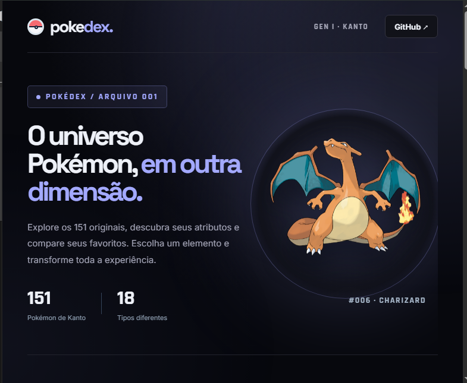
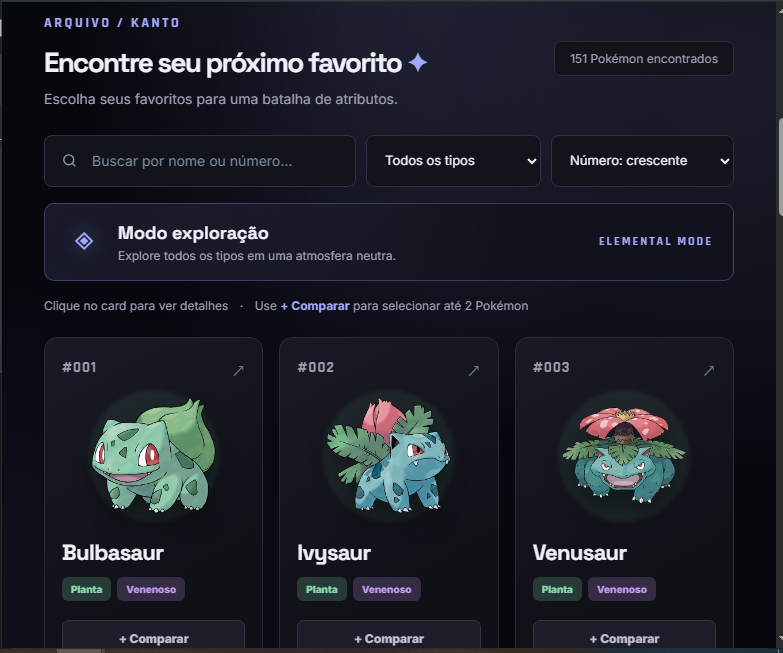
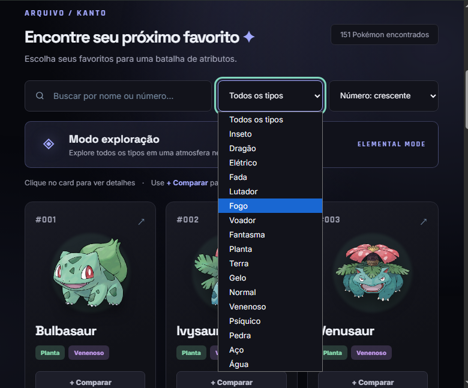
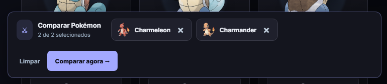
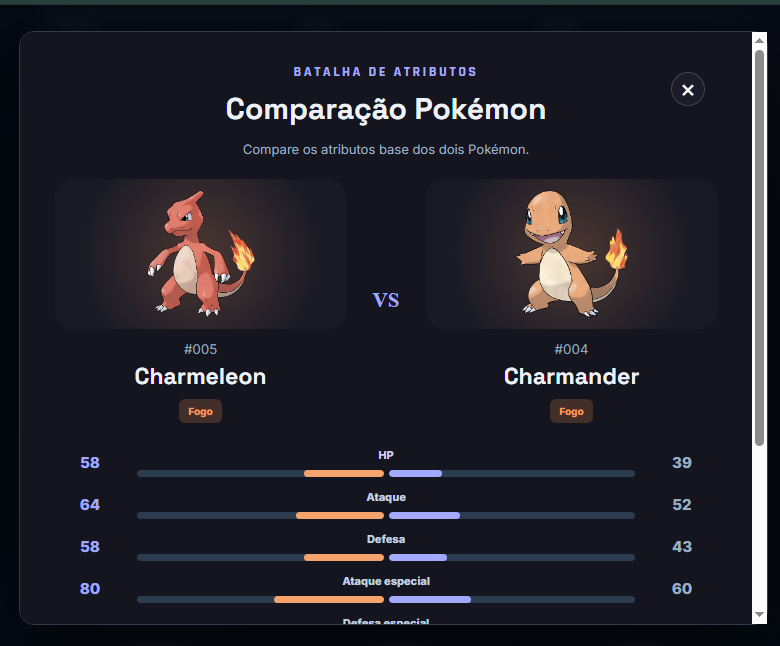

# Pokédex — Dark Elemental ⚡

Uma Pokédex interativa com visual **dark**, efeitos temáticos para os tipos de Pokémon e uma ferramenta para **comparar dois Pokémon lado a lado**. Desenvolvida com **HTML, CSS e JavaScript**, consumindo dados da [PokéAPI](https://pokeapi.co/).



## ✨ Funcionalidades

- **151 Pokémon da primeira geração (Kanto)**, com imagens, tipos e atributos.
- **Busca por nome ou número** e filtros pelos tipos de Pokémon.
- **Ordenação** por número crescente/decrescente e nome A–Z/Z–A.
- **Atmosfera elemental dinâmica:** ao selecionar um tipo, o tema ganha cores e partículas animadas relacionadas ao elemento.
- **Cards interativos** com acesso aos detalhes de cada Pokémon.
- **Comparador de dois Pokémon**, exibindo seus atributos base em barras lado a lado.
- **Layout responsivo** com identidade visual escura e tipografia moderna.

## 🖥️ Explore os Pokémon

A página reúne os Pokémon em um grid de cards com imagem, numeração, nome e tipos. Clique em um card para explorar suas informações ou use **+ Comparar** para selecioná-lo.



## 🔎 Busca, filtros e temas elementais

Utilize a barra de pesquisa para encontrar um Pokémon pelo nome ou número. O seletor de tipos filtra a coleção e ativa a ambientação correspondente; o menu de ordenação permite reorganizar os resultados.



## ⚔️ Comparação de Pokémon

**1. Selecione dois Pokémon:** clique em **+ Comparar** nos cards desejados. A bandeja inferior exibe os selecionados, permite removê-los ou limpar a seleção.



**2. Compare os atributos:** clique em **Comparar agora** para abrir a janela de comparação, com imagens e indicadores de **HP, ataque, defesa, ataque especial, defesa especial e velocidade**.



## 🛠️ Tecnologias

- **HTML5** — estrutura semântica da interface.
- **CSS3** — grid responsivo, animações e temas elementais.
- **JavaScript** — carregamento dos dados, busca, filtros, modais e comparação.
- **[PokéAPI](https://pokeapi.co/)** — dados e estatísticas dos Pokémon.
- **Google Fonts** — Inter, Space Grotesk e Rajdhani.

## 🚀 Como executar

1. Clone o repositório:

   ```bash
   git clone https://github.com/DevElyShow/Pokedex.git
   ```

2. Entre na pasta do projeto e abra o arquivo `index.html` com **Live Server** no VS Code, ou utilize um servidor HTTP local.
3. Mantenha a conexão com a internet para carregar dados, sprites e fontes externas.

Não é necessário instalar dependências ou executar um processo de build.

## 📁 Estrutura principal

```text
pokedex-teste/
├── index.html
├── assets/
│   ├── css/
│   │   ├── global.css
│   │   ├── pokedex.css
│   │   └── elemental.css
│   ├── js/
│   │   ├── pokemon-model.js
│   │   ├── poke-api.js
│   │   └── main.js
│   └── img/
├── docs/
│   └── images/
│       ├── dashboard.png
│       ├── grid-pokemon.png
│       ├── filtros.png
│       ├── selecao-comparacao.png
│       └── comparacao.png
└── README.md
```

## 🔗 Links

- **Repositório:** [GitHub — Pokédex](https://github.com/DevElyShow/Pokedex)
- **Desenvolvedor:** [GitHub](https://github.com/DevElyShow) · [LinkedIn](https://www.linkedin.com/in/elydeivisoncesar/)
- **API:** [PokéAPI](https://pokeapi.co/)

---

Projeto de portfólio para praticar consumo de APIs REST, manipulação do DOM, organização de código JavaScript e desenvolvimento de interfaces responsivas.
