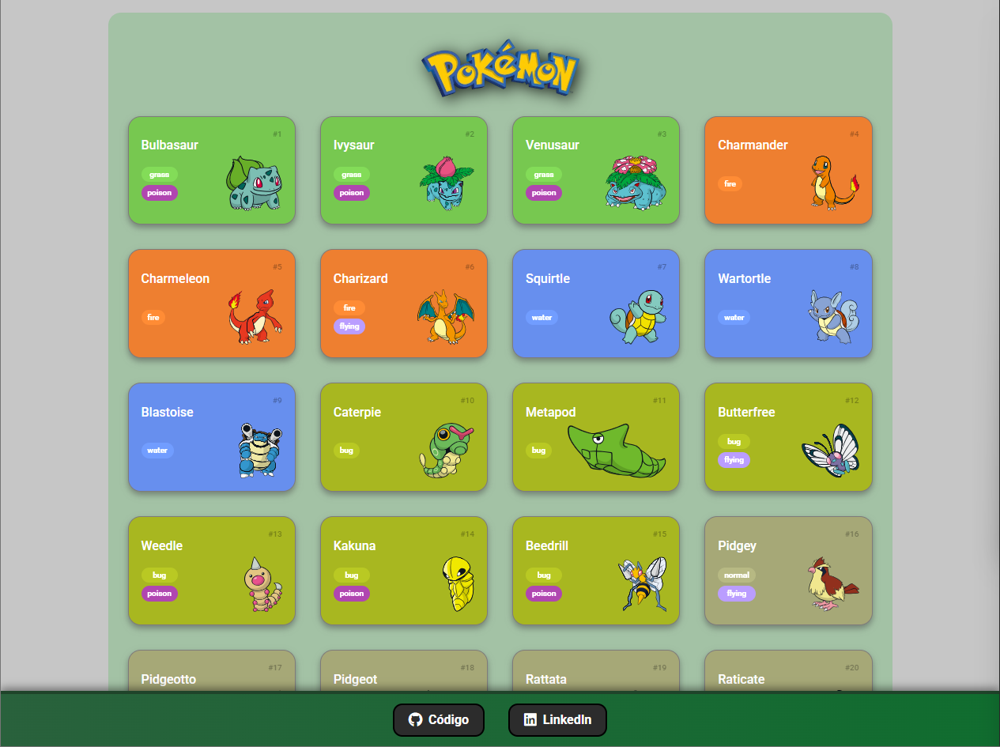
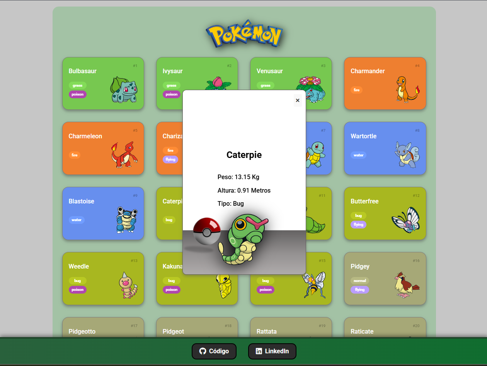

# 🎮 Pokédex Web App

Uma Pokédex desenvolvida consumindo a API pública Pokémon, exibindo lista dinâmica de Pokémon, detalhes em modal e paginação com botão "Load More".

🔗 **Deploy:** https://pokedex-azure-sigma.vercel.app  
📂 **Repositório:** https://github.com/DevElyShow/Pokedex  

---

## 🚀 Tecnologias utilizadas

- HTML5
- CSS3
- JavaScript (Vanilla JS)
- Consumo de API REST
- Deploy na Vercel

API utilizada:
- PokeAPI → https://pokeapi.co/

---

## 📸 Demonstração

### Tela Principal


### Modal de Detalhes


---

## ⚙️ Funcionalidades

✔️ Listagem dinâmica de Pokémon  
✔️ Paginação com botão "Load More"  
✔️ Modal com:
- Nome
- Peso
- Altura
- Tipo
- Imagem oficial  

✔️ Layout responsivo  
✔️ Footer fixo com links para GitHub e LinkedIn  

---

## 🧠 Aprendizados

Neste projeto pratiquei:

- Manipulação de DOM
- Consumo de API com fetch
- Async/Await
- Organização de código em módulos
- Estruturação de layout com CSS
- Deploy de aplicação front-end

---

## 📦 Como rodar o projeto localmente

```bash
# Clone o repositório
git clone https://github.com/DevElyShow/Pokedex.git

# Entre na pasta
cd Pokedex

# Abra o index.html no navegador
